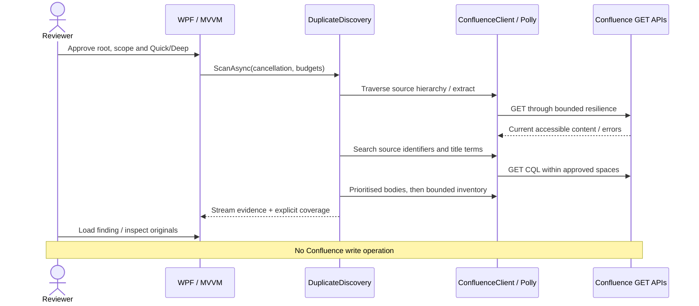
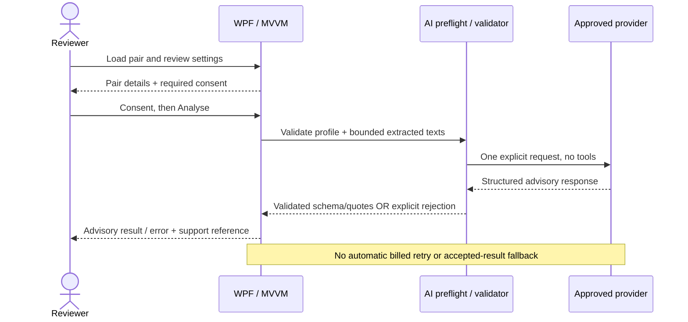

# DocTwin: client contracts and operations

Status: hardened desktop prototype, 17 November 2026. This is a local,
Confluence-ready document, not a publication or production certification.
Intended documentation parent, subject to owner approval:
https://myobconfluence.atlassian.net/wiki/spaces/MSS/pages/10915381451/Workday+Integrations

## Scope and trust boundaries

DocTwin is a .NET 10 Windows WPF client. It has **no inbound web API**, web
controllers, Workday execution connector, SQL Server/EF persistence or middleware
transaction engine. OpenAPI/Swagger server routes, Workday payload contracts,
database migrations, sagas and outboxes are therefore not applicable. The
following contracts describe the real outbound clients and local data, rather
than inventing endpoints for unrelated infrastructure.

Confluence traffic is GET-only. No create/edit/archive/delete operation exists.
Approval of a legacy-page retirement is a human decision outside this app.
API tokens remain in memory or, after separate consent, Windows Credential
Manager. Non-secret profiles contain only provider/model/endpoint/key-variable
name. Never attach credentials, company page bodies or environment dumps to a
support ticket.

## Outbound Confluence contract

Base URI for a scoped API token:
`https://api.atlassian.com/ex/confluence/{cloudId}/wiki/`.
For a non-scoped token: `https://{site}.atlassian.net/wiki/`.
Authentication: Basic base64(email:token), HTTPS, cookies disabled and redirects
blocked. Base64 is an encoding, not encryption. TLS protects the connection.
Only standard Atlassian Cloud domains are supported for user site input.

| Method | Relative path | Purpose / required response |
| --- | --- | --- |
| GET | `rest/api/user/current` | Authenticated non-anonymous `accountId` |
| GET | `api/v2/pages?limit=1` | Connection read probe; object with `results` array |
| GET | `api/v2/pages/{id}?body-format=storage` | Matching string ID, nonempty title, `body.storage.value` string; version, space, owner and parent metadata when available |
| GET | `api/v2/{resource}/{id}/direct-children?limit=100` | Hierarchy references; resource is pages/folders/databases/whiteboards/embeds from a fixed content-type map |
| GET | `api/v2/spaces?limit=100&keys={encodedKey}` | Resolve exactly one accessible space with the requested key |
| GET | `api/v2/pages?limit=100&status=current[&space-id={id}]` | Accessible current page inventory |
| GET | `rest/api/search?limit=100&expand=content.space&cql={encodedCql}` | Title search results wrapped in `content`; retain current pages only |

Search CQL shape: `type = page AND (title ~ "INT002") AND space IN ("PB")`.
Terms and space keys are quoted/escaped, then the whole CQL is URI-encoded.
No known candidate page ID is inserted into automatic retrieval. Do not append
`status=current` to CQL; this installation rejected that clause. Search result
metadata is filtered for current status instead.

List responses contain a `results` array and may contain `_links.next`. The
client validates the host, copies only its cursor into the original path/query,
and rejects repeated/missing cursors. It does not follow arbitrary supplied
hosts, paths or query parameters with credentials.

Page version may be missing, in which case the page can be compared but **cannot
be saved as a current local human review** until a known positive version is
retrieved. Empty/unextractable/oversized bodies are explicit extraction outcomes,
never successful empty comparisons. Hierarchy traversal still continues through
known nodes where possible.

### Resilience contract

- Polly pipeline, per client instance: concurrency limiter -> circuit breaker
  -> retry -> HTTP send. Concurrency limit is two sends through response
  headers, with no queue; rejected work fails explicitly. This is not a
  site-wide requests-per-second governor or a distributed quota.
- At most three attempts for HTTP 429/502/503/504 and transport exceptions.
  Backoff is 1 then 2 seconds when the server does not supply Retry-After,
  plus 100-399 ms jitter. Date/delta Retry-After values are respected; past
  dates become zero. A requested delay over 30 seconds stops the operation.
- Circuit sampling: minimum four logical read outcomes in 30 seconds, transient
  failure ratio >= 75%; break for 30 seconds. A successful half-open probe
  closes it. Authentication and malformed response errors do not count as
  transient service outages.
- GET timeout: 45 seconds. View-model operation deadline: three minutes, or
  60 minutes for discovery. Cancellation reaches sends and backoff. CPU work
  already running may complete before cancellation is observed.
- No fabricated-success fallback. Skips, caps, cancellation and search failures
  must remain visible as incomplete coverage. Do not interpret 'no matches' as
  proof that no redundancy exists.

## Optional AI contract

Both selected page texts, titles, IDs, available parent/owner metadata, source
hierarchy context and extraction limitations are sent **only** after per-pair,
per-configuration consent. Confluence credentials are never included. Prompts
label page content untrusted; Copilot tools, session store, memory and telemetry
are disabled in the configured session. These controls are not a guarantee
against every model error or a substitute for provider policy approval.

| Adapter | Transport | Authentication | Request / acceptance |
| --- | --- | --- | --- |
| OpenAICompatible | One POST to an approved chat-completions endpoint | Bearer key from named environment variable | `model`, `max_completion_tokens=8192`, system/user messages and strict `response_format.json_schema`; require a completed non-refusal message |
| Claude | One POST to approved HTTPS Messages endpoint | `x-api-key` and `anthropic-version: 2023-06-01` | `model`, `max_tokens=8192`, system/user messages and `output_config.format` JSON schema; require `end_turn` and text blocks |
| GitHubCopilot | Copilot SDK/CLI logged-in-user session | `copilot login`, separate from IDE/M365 sign-in | Structured response schema; no tools, session persistence or memory; two-minute wait bound |

Profiles are validated before sending even if not saved. Endpoints cannot carry
embedded credentials, query strings or fragments; require HTTPS except loopback
HTTP for an OpenAI-compatible local server. Variables are read from process
scope, then Windows user scope. The app never copies or saves the variable's
secret value into profile JSON.

Maximum combined page-text/hierarchy input: 160,000 characters, no silent
truncation. This is not a token-limit guarantee: model limits and JSON-envelope
overhead still apply. HTTP responses are bounded to 1 MB. No AI POST is
silently retried; manually repeating a request may incur another charge.

Result fields (all required): `relationship`, `summary`, `evidence`,
`suggestedAction`, `uncertainties`. Unknown fields/enum values, invalid shapes,
incomplete responses and unsupported evidence are rejected.

- Relationships: ExactDuplicate, NearDuplicate, Related, PotentialConflict,
  Unrelated, Uncertain.
- Actions: KeepSourceAndReference, ReviewCandidateAsPreferred,
  OwnerReconciliation, KeepBoth, NoAction, Uncertain.
- Evidence: Kind, SourceQuote, CandidateQuote, Explanation (camelCase in JSON).
  Kind is Similarity, Difference, SourceOnly, CandidateOnly or PotentialConflict.
- Quotes must be exact contiguous excerpts of the proper extracted page text.
  Similarity/Difference/PotentialConflict require quotes from both pages;
  SourceOnly/CandidateOnly require an empty quote on the absent side.
- Summaries <= 8,000 characters; <= 50 evidence entries with quotes/explanation
  <= 4,000 each; <= 30 nonempty uncertainty entries, <= 4,000 characters each.
- Evidence-backed classifications do not determine canonical ownership, approval,
  factual correctness or permission to retire a page.

## Local storage and export contract

`%LOCALAPPDATA%\DocTwin` contains `ai-profiles.json`, `appearance.json`,
`reviews.json` when used, and `logs`. Page bodies are not cached there.

Review fields: Site, SourceId, CandidateId, SourceVersion, CandidateVersion,
Decision, Notes, ReviewedAt. IDs must be different positive numeric values;
versions must be positive/known; notes are non-null and at most 4,000 characters;
site must be an HTTPS Atlassian Cloud origin; timestamp and enum must be valid.
The store retains the latest record per directed site/source/candidate pair,
including the reviewed versions. It is not a complete append-only decision
history. Changed versions require re-review. Maximum 10,000 pairs / 8 MB JSON.
AI profiles are bounded to 64 KB and appearance settings to 1 KB.

Saves hold an exclusive `.lock` lease across read-modify-write, flush a unique
same-directory temporary file, and atomically replace the committed path.
Concurrent writers fail explicitly and can retry; acknowledged updates are not
silently lost. Single-profile saves merge against the latest snapshot. Invalid
existing data is not overwritten. Local NTFS-like filesystem semantics are
assumed; network shares and power-loss durability are not certified.

HTML/CSV exports include scan scope/coverage/warnings, captured page versions,
source context, original links, relationship/match basis, title/lexical coverage,
suggestions and version-checked human notes. They do not automatically include
AI output. HTML text is encoded and CSV cells are quoted with formula-prefix
protection. Exports contain company information; use approved locations and
retention. A failed export may leave a partial destination file.

## Error catalogue and troubleshooting

The labels below are **support catalogue identifiers**, not codes returned by
an inbound API. Runtime messages and support references are the source of truth.

| Support label | Visible condition | Operator action |
| --- | --- | --- |
| DT-CONNECT-401 | Invalid/expired/revoked token | Check account/token type, re-enter and test; revoke separately in Atlassian if compromised |
| DT-ACCESS-403 | Permission/scope/policy denied | Ask page/space owner and administrator; do not broaden scope without approval |
| DT-MISSING-404 | Not found or not visible | Check site/Cloud ID/link; 404 does not prove deletion |
| DT-RETRY-429 | Rate limiting / long Retry-After | Wait the requested period; reduce scope; no automatic early retry |
| DT-CIRCUIT | Reads paused after repeated transients | Wait at least 30 seconds, check VPN/provider status, then retry |
| DT-CONCURRENCY | Local in-flight send limit | Wait for active work; do not start parallel scans to bypass it |
| DT-NETWORK | Network/TLS/timeout/response bound | Check VPN and endpoints; no successful comparison assumed |
| DT-EXTRACT | Empty, unsupported or size-limited page | Read original and numeric extraction warnings; do not call it an analysed non-match |
| DT-COVERAGE | Hierarchy/search/inventory cap or failure | Narrow/increase approved bounds as appropriate; rerun fresh; preserve warnings |
| DT-AI-READY | Grey Analyse button | Load a pair, wait for idle, review provider and tick visible consent above the button |
| DT-AI-AUTH | AI HTTP 401/403 or CLI auth | Check named variable or copilot login, subscription, model and organisational policy |
| DT-AI-MODEL | AI 400/404/413 | Check endpoint/model, structured output and token/input limits; no truncation fallback |
| DT-AI-QUOTA | AI 429 | Check quota/billing and wait; manual retries may be charged |
| DT-AI-EVIDENCE | Invalid JSON, quotes, refusal or incomplete response | No accepted result; retain local deterministic evidence; do not bypass validation |
| DT-LOCAL | Invalid JSON, access, quota or write contention | Preserve file, check free space/access, wait for other writer, restore approved backup if needed |
| DT-LOG | Diagnostics unavailable/write failure | Check local log folder access and free space; report that the support log may be incomplete |
| DT-FATAL | Unexpected dispatcher error | App notifies and stops; restart only after preserving permitted support evidence |

Support bundle: app/build version, operation, time, support-reference GUID,
mode/budgets and content-free logs through an approved channel. Do not include
exports, screenshots or review notes without content-owner permission. Serilog
JSON events include operation names, duration, outcome, transient status and
correlation, but no tokens, page content, titles, URLs, email or exception
messages. Up to seven approximately 5 MB files are retained locally. A fatal
event records exception type/boundary only, not a potentially sensitive stack.

## Build, deployment and rollback runbook

1. Use Windows with .NET 10 Desktop runtime; install a compatible SDK to build.
   No `global.json` is pinned; CLI SDK selection must be reviewed in release CI.
2. Restore/build using the repository entry point:
   `dotnet restore .\DocTwin.sln`, then
   `dotnet build .\DocTwin.sln --no-restore -warnaserror`.
   Stop the debugger before rebuilding the running executable.
3. Run registered repository tests and coverage **after the native Visual Studio
   inventory/registration blocker is resolved**. A build or session check is not
   xUnit discovery or 90% coverage evidence. Consult the readiness document.
4. Check direct/transitive dependency advisories and licensing; capture the
   exact version/build and test evidence. Dependency updates require regression.
5. Produce a framework-dependent Windows package, for example
   `dotnet publish .\DocTwin\DocTwin.csproj -c Release --self-contained false`.
   Keep the entire publish directory together. This does not sign, install,
   distribute or establish policy approval.
6. Before rollout, complete signing/distribution, token/OAuth-policy review,
   provider/data-handling approval, persistent tests/coverage, longer soak,
   accessibility and user acceptance. Use a staged approved pilot first.
7. On the pilot machine, configure connection and AI profiles locally. Never
   ship a populated Credential Manager entry, environment dump or API key.
8. Smoke test connection, approved Quick scan, pair review, AI consent with
   synthetic content, local save, export and Help in both themes.

Rollback: close DocTwin normally, preserve local review/profile backups and
support logs, then replace the complete application folder with the last
approved package. Do not delete user data as rollback. Older builds may reject
newer JSON schemas; validate compatibility or restore a known-good backup with
owner approval. Token revocation and AI key rotation are separate administrative
operations, not binary rollback actions.

## Sequence diagrams

These Mermaid blocks are source diagrams. Render using an approved Confluence
macro or attach an approved rendering; publication is manual and authorised.

